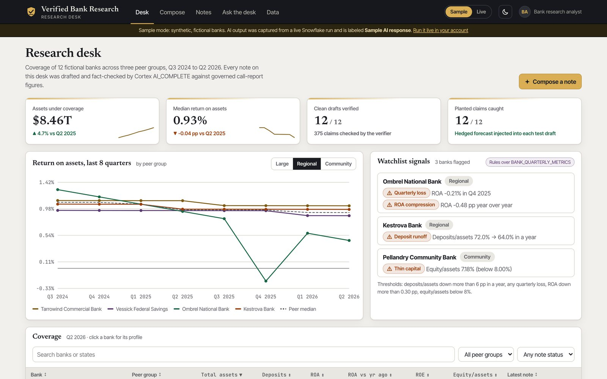

# Verified Bank Research

**An AI research note is only useful if every number in it can be checked.** This pack drafts peer research notes on banks with Snowflake Cortex AI. The drafting model may use only a governed fact pack of call-report figures. A second Cortex call fact-checks every claim, and a deterministic matcher ties every figure to its source row. A note that passes gets the *Verified* hallmark; anything else is marked *Needs review*.

The app is branded as **Verified Bank Research**, the research desk of a fictional bank (see [docs/DESIGN.md](docs/DESIGN.md)).

- **Guide:** https://sfc-gh-jsoliz.github.io/sfguide-verified-bank-research/
- **Try it, no account:** https://sfc-gh-jsoliz.github.io/sfguide-verified-bank-research/try/



## What it does

| Screen | What you see | Snowflake capability |
|---|---|---|
| **Desk** | Coverage KPIs, 8-quarter ROA by peer group with the peer median, watchlist signals, a sortable and filterable coverage table, and a bank profile drawer | Snowflake SQL (`WATCHLIST_SIGNALS` view) |
| **Compose** | Pick a subject, peers and quarter, optionally plant an unsupported claim, and watch the pipeline: fact pack, grounded draft, verifier, figure tracing, store | Cortex `AI_COMPLETE`; `AI_COMPLETE` structured output for the verifier |
| **Notes** | Every stored note with status, claims checked, rejected claims, figures traced and run time; open one to read it with its *assay margin* (verifier findings plus the source row for each numbered figure) | `REPORTS` table |
| **Ask the desk** | Ask questions in plain language; see the answer, the rows returned and the SQL | Cortex Agents (`DATA_AGENT_RUN`) with Cortex Analyst over a semantic view |
| **Data** | Objects, the semantic view, the DATA RULES given to the model and the verifier's output schema | Semantic Views |

The app has a **Sample / Live** switch. Sample mode replays data and AI output captured from a live run (`data/sample/`), labeled **Sample AI response**. Live mode runs every call on Snowflake and never falls back to sample data: if a call fails, the app shows the error.

## How a note is verified

1. **Fact pack (SQL).** `BANK_QUARTERLY_METRICS` rows for the subject and peers, for the reporting quarter and a year earlier. It precomputes display strings ("$151.7B", "0.46%"), year-over-year changes in percentage points and the asset rank in the group, so the model never calculates.
2. **Grounded draft (`AI_COMPLETE`).** DATA RULES: copy display values verbatim, no estimates, no hedging words, no ratios or relative changes, no real company names.
3. **Verifier (`AI_COMPLETE` with `response_format`).** Returns `{status, residual_hedges, findings[claim, reason, verdict]}`. The note is Verified only if every checked claim is SUPPORTED.
4. **Figure tracing (Python, deterministic).** Every `$…B/T/M`, `%` and `pp` figure is matched to a fact-pack value within display rounding. Unmatched figures are flagged in the margin.
5. **Store.** Note, fact pack, findings and timings go to `REPORTS`.

On this synthetic data set, the captured run had all 12 clean drafts Verified and caught the planted claim in all 12 test drafts. Results from a fresh run can differ, because AI output varies; see [Known limitations](#known-limitations).

## Prerequisites

- A Snowflake account (Standard Edition or higher) in a region with **Cortex AI functions, Cortex Analyst and Cortex Agents**, and access to the `claude-sonnet-4-5` model. To use another model, change `MODEL` in `app/research.py`; cross-region inference may be needed.
- **ACCOUNTADMIN**, or a role that can create roles, databases and warehouses, for part 1 of setup only. Everything else runs as the pack role `SNOWPACK_BANK_RESEARCH_ROLE`, which gets `SNOWFLAKE.CORTEX_USER`.
- To run the app locally: Python 3.11+, `streamlit` (tested 1.55), `snowflake-snowpark-python` (tested 1.42), `altair`, `pandas`, and a key pair registered on your Snowflake user.
- Sample mode and the hosted example need nothing but a browser.

## Quick start: no account

Open the [hosted example](https://sfc-gh-jsoliz.github.io/sfguide-verified-bank-research/try/), or run it from a clone:

```bash
python3 -m http.server 8000 --bind 127.0.0.1 --directory docs
# open http://127.0.0.1:8000/try/
```

You can also run the Streamlit app in Sample mode without a connection:

```bash
pip install streamlit snowflake-snowpark-python altair pandas
cd app && streamlit run streamlit_app.py      # opens in Sample mode
```

## Run it live

1. **Setup.** Run [`app/setup_synthetic.sql`](app/setup_synthetic.sql) top to bottom in one worksheet (about 11 to 15 seconds). For real US call-report data, mount the free **Financial Data Package** listing (`SNOWFLAKE_PUBLIC_DATA_FINANCIAL_PACKAGE`) and run [`app/setup.sql`](app/setup.sql) instead.
2. **App, option A: Streamlit in Snowflake (not yet verified in Snowsight).** Upload `app/streamlit_app.py`, `app/research.py`, `app/environment.yml`, `app/.streamlit/config.toml` and `app/sample/*.json` to the stage `SNOWPACK_BANK_RESEARCH.CORE.APP_STAGE` (keep the folder structure), then:
   ```sql
   USE ROLE SNOWPACK_BANK_RESEARCH_ROLE;
   CREATE OR REPLACE STREAMLIT SNOWPACK_BANK_RESEARCH.CORE.VERIFIED_BANK_RESEARCH_APP
     FROM @SNOWPACK_BANK_RESEARCH.CORE.APP_STAGE MAIN_FILE = 'streamlit_app.py'
     QUERY_WAREHOUSE = SNOWPACK_BANK_RESEARCH_WH;
   ```
   Open it from Snowsight under Projects > Streamlit. It starts in Live mode.
3. **App, option B: run locally with key-pair auth** (the app never collects credentials):
   ```bash
   SNOWFLAKE_ACCOUNT=<account_identifier> SNOWFLAKE_USER=<YOUR_USER> \
   SNOWFLAKE_PRIVATE_KEY_PATH=<path/to/rsa_key.p8> streamlit run app/streamlit_app.py
   ```
4. **Notebook (optional).** [`notebook/lab-01-verified-institution-agent.ipynb`](notebook/lab-01-verified-institution-agent.ipynb) walks through the same pipeline cell by cell and creates the agent.
5. **Cleanup.** Run [`app/teardown.sql`](app/teardown.sql).

### Objects created

| Object | Type | Purpose |
|---|---|---|
| `SNOWPACK_BANK_RESEARCH_ROLE` | Role | Owns the pack; `SNOWFLAKE.CORTEX_USER` database role |
| `SNOWPACK_BANK_RESEARCH` | Database | Everything below lives in `.CORE` |
| `SNOWPACK_BANK_RESEARCH_WH` | Warehouse | XSMALL, `AUTO_SUSPEND = 60` |
| `BANKS` | Table (view on real data) | Bank directory and peer group |
| `BANK_QUARTERLY_METRICS` | Table (view on real data) | One row per bank per quarter: assets, deposits, net income, ROA, ROE, capital, loans |
| `WATCHLIST_SIGNALS` | View | Deterministic watchlist rules shown on the Desk |
| `DATA_SOURCE_INFO` | View | Synthetic vs real-data marker |
| `BANK_RESEARCH_SV` | Semantic view | Business meaning for Cortex Analyst |
| `BANK_RESEARCH_AGENT` | Cortex Agent | Ask the desk; one Cortex Analyst tool over the semantic view |
| `REPORTS` | Table | Notes, fact packs, verifier findings and timings |
| `APP_STAGE` | Stage | Streamlit in Snowflake app files |
| `VERIFIED_BANK_RESEARCH_APP` | Streamlit | Only if you deploy option A |

## Cost and time

Measured in a test account on an XSMALL warehouse in November 2026:

- **Setup:** 11 to 15 s. Teardown: about 4 s.
- **One note:** about 5 to 7 s to draft and 11 to 17 s to verify (two `AI_COMPLETE` calls; one draft took 25 s). About 20 to 30 s end to end in the app.
- **One agent question:** 13 to 27 s.
- **Credits:** one full build-and-verify session (setup, about 60 notes, a dozen agent questions, teardown) used about 0.9 warehouse credits and about 2.1 AI credits for `AI_COMPLETE`, or roughly 0.035 AI credits per note. Agent questions are billed separately under Cortex Agents. Your prices and model choice change these numbers.

## Known limitations

- **AI output varies.** Wording, the number of claims checked and occasionally a verdict differ between runs. The verifier is itself a model, so it can miss an error or reject a correct claim. Treat *Verified* as "passed an automated check", not as sign-off.
- **The figure tracer matches numbers, not meaning.** It confirms a figure exists in the fact pack within display rounding, not that it is attributed to the right bank. The verifier is what checks attribution and comparisons.
- **The agent's answers are not verified.** Ask the desk answers from SQL results but can still add qualitative wording ("about half"); only notes go through the verifier.
- **Sample mode replays captured runs.** In Sample mode the peers are the subject's peer group and the quarter is 2026-06-30; Live mode lets you choose both.
- **The real-data path (`app/setup.sql`) was not re-run for v2.** The listing wasn't mounted in the test account. The view logic is from the earlier version, and peer groups are derived from total assets.
- **Streamlit in Snowflake: not yet verified in Snowsight.** The app object was created and its files staged in testing, but the UI was exercised locally against Snowflake with key-pair auth, not inside Snowsight.
- Synthetic data only. Watchlist thresholds are illustrative.

## Customize with Cortex Code

- "Explain how the fact pack, the DATA RULES and the verifier fit together in `app/research.py`, then map `BANK_QUARTERLY_METRICS` to my call-report tables without changing any objects."
- "Add net interest margin and the efficiency ratio to the fact pack, the semantic view and the note template, and extend the citation matcher and the verifier rules to cover them."
- "Replace the synthetic data with my development tables. Propose least-privilege grants for the pack role and a validation plan that compares Verified rates before and after."

## Data

Synthetic and deterministic; see [data/README.md](data/README.md) for the generator and the planted stories (ROA compression with a quarterly loss, deposit runoff, thin capital, and a planted hedged claim in each test draft).

## Learn more

- [AI_COMPLETE](https://docs.snowflake.com/en/sql-reference/functions/ai_complete) and [structured outputs](https://docs.snowflake.com/en/sql-reference/functions/ai_complete-structured-outputs)
- [Cortex Agents](https://docs.snowflake.com/en/user-guide/snowflake-cortex/cortex-agents) and [running agents from SQL](https://docs.snowflake.com/en/user-guide/snowflake-cortex/cortex-agents-run)
- [Cortex Analyst](https://docs.snowflake.com/en/user-guide/snowflake-cortex/cortex-analyst) and [semantic views](https://docs.snowflake.com/en/user-guide/views-semantic/overview)
- [Streamlit in Snowflake](https://docs.snowflake.com/en/developer-guide/streamlit/about-streamlit)

## License and disclaimer

Apache 2.0 (see [LICENSE](LICENSE)). Fonts in `docs/fonts/` are under the SIL Open Font License (license files alongside).

This is an illustrative example provided as-is. It is not an official Snowflake product and is not supported by Snowflake Support. It uses synthetic data, its logic is illustrative, and it is not investment, credit or regulatory advice. Review and test before any production use.

Owner: Javier Soliz · Last reviewed: November 2026
